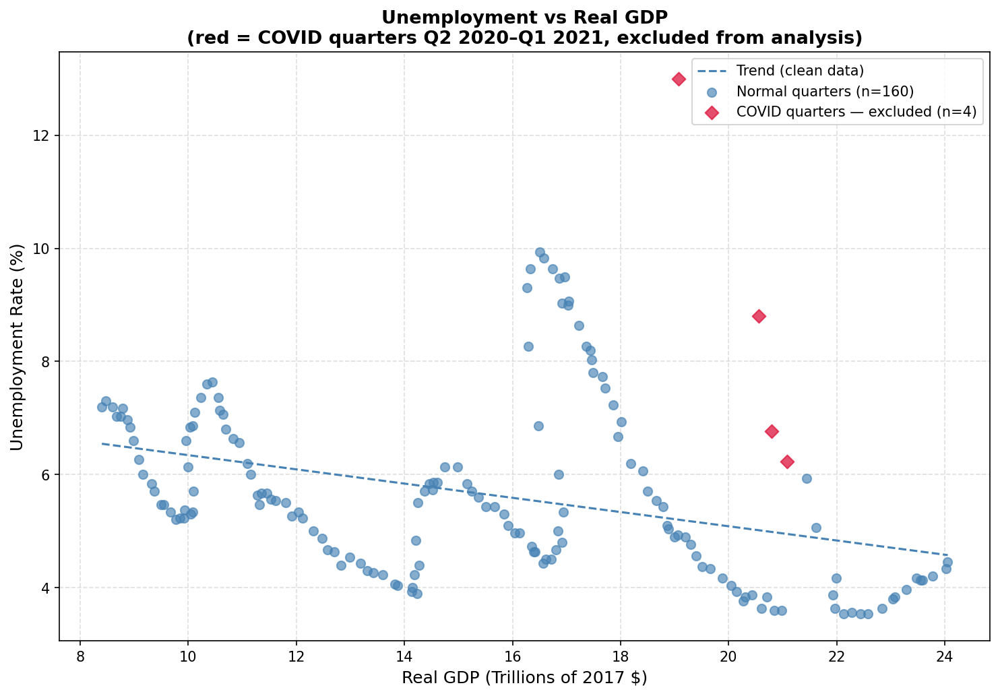
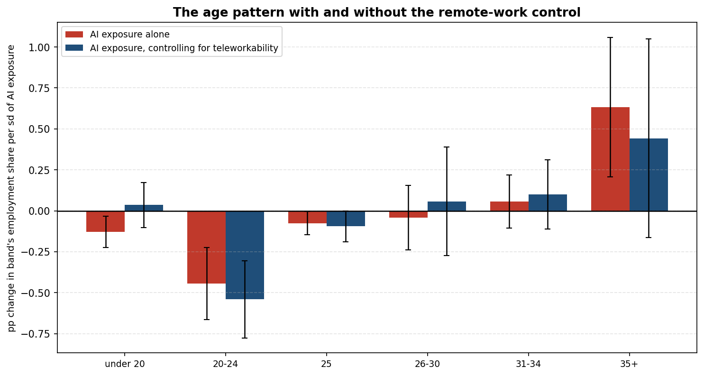
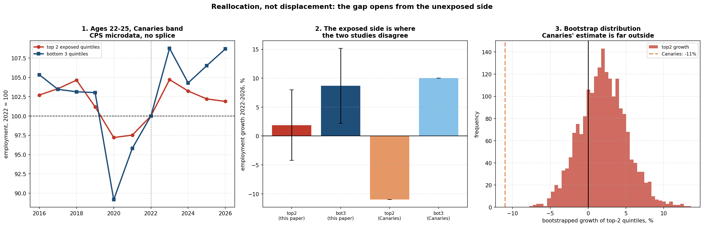

# Okun's Law in the AI Era

**Output, employment, and generative-AI exposure in the United States, 2000-2026**

Maximilian Stober and Esther Gewirtz

> **Readers arriving from the working paper.** The paper, *Underperformance Without Contraction: Entry-Level Employment and AI Exposure in Nationally Representative Data*, corresponds to [Part III](#part-iii-entry-level-employment-and-ai-exposure). Its central result, that the young-worker share of employment falls in AI-exposed occupations after 2022, is reported here as established. Parts I and II address a separate question, whether AI changed the aggregate and sector-level relationship between output and employment, and find that it did not. The two results are compatible: a change in the age composition of particular occupations need not alter aggregate employment.

---

## Overview

This repository contains the code and documentation for an empirical study of whether the relationship between output and employment in the United States changed after the public release of large language models in late 2022, and whether any change can be attributed to artificial intelligence.

The study proceeds at three levels of aggregation. At the level of the national economy, it documents a statistically extreme break in the output-unemployment relationship after 2022 and attributes most of that break to monetary tightening. At the level of industries, it finds that exposure to AI predicts real productivity growth, but that the relationship predates generative AI. At the level of occupations, it replicates and tests a widely cited finding that generative AI has reduced the employment of young workers in exposed occupations (Brynjolfsson, Chandar and Chen, 2026), using nationally representative household survey data in place of proprietary payroll records.

The occupational analysis is written up as a separate working paper, *Underperformance Without Contraction: Entry-Level Employment and AI Exposure in Nationally Representative Data*, which is distributed separately from this repository. Every estimate in that paper is reproduced by the scripts listed in [Repository structure](#repository-structure).

---

## Summary of findings

| Question | Finding | Status |
|---|---|---|
| Did the output-unemployment relationship break after Q4 2022? | The rolling correlation moves from approximately −1.0 to +0.81 (block bootstrap p ≈ 0.0005). The break persists, at a smaller magnitude, in the difference form (+0.55). | Established |
| What caused the break? | A single common factor explains 72 percent of the variance in sector employment growth and tracks the federal funds rate at a lag of eight to nine quarters (r = −0.74, circular-shift bootstrap p < 0.0001). | Established |
| Does AI exposure predict sector-level outcomes? | Exposure predicts real productivity growth across sectors (r = +0.77; a purpose-built replaceability score gives r = +0.90). The relationship is strongest in 2013-2019 and therefore predates generative AI. | Established, but not attributable to generative AI |
| Does the young-worker share of employment fall in AI-exposed occupations? | Yes. The 22-25 share falls by 0.40 percentage points per standard deviation of exposure after 2022 (p = 0.0001), and the estimate survives every confounder tested. | Established |
| Is the effect specific to young workers? | The decline is concentrated at ages 20-25. A corresponding rise at ages 35 and over is significant in the baseline but not once teleworkability is controlled. | Partly established |
| Does the published 11 percent decline replicate? | No. Employment of 22-25 year olds in the two most exposed quintiles is statistically indistinguishable from zero growth, and the reported decline is rejected at p < 0.001. | Established |
| Does the published mechanism replicate? | Of three mechanism claims, one reproduces (adjustment through employment rather than wages) and two do not (reduced hiring rather than separations; concentration in substitutive AI use). | Mixed |
| Did AI cause any of these effects? | Not identified. No source of exogenous variation in occupational AI exposure is available. | Not established |

---

## Part I. The aggregate output-employment relationship

### The break

Okun's law describes the negative relationship between deviations of output from potential and deviations of unemployment from its natural rate. Using real GDP (`GDPC1`), potential GDP (`GDPPOT`), the unemployment rate (`UNRATE`) and the natural rate (`NROU`), the 12-quarter rolling correlation between the output gap and the unemployment gap held near −1.0 for two decades before inverting to +0.81 after Q4 2022. A distribution-free block bootstrap places the probability of an inversion of that size under a continuation of the pre-2022 regime at approximately 1 in 2,000.

The gap form amplifies the signal, because persistently one-sided gaps inflate within-window correlation. Re-estimated in the difference form, the inversion persists with a peak rolling correlation of about +0.55. Both figures are reported together throughout.



### Attribution to monetary policy

The break coincides with the 2022-2023 tightening cycle as well as with the release of ChatGPT. Hiring slowed in eight of nine sectors after 2022, and one common factor explains 72 percent of sector employment growth. That factor tracks the federal funds rate lagged eight to nine quarters (r = −0.74, n = 75, 2006-2026), a result that holds under a circular-shift bootstrap and is directionally corroborated on identified monetary policy shocks. The factor has been unwinding on the schedule the lag implies.

---

## Part II. Sector-level analysis

### The choice of labor measure

Measured on unemployment, AI exposure across nine sectors predicts a smaller breakdown in the output-employment relationship. This result is an artifact of the instrument. High-exposure service sectors, finance in particular, operate near their frictional unemployment floor, where output growth cannot lower unemployment further; an Okun test on unemployment therefore records no response in these sectors regardless of what happens to hiring.

Measured on real productivity (real output per worker), the result reverses: AI exposure predicts the decoupling of output from employment (r = +0.77, p = 0.016). A job-replaceability score combining GPT-4 task exposure with five O\*NET Work Context variables predicts it more strongly (r = +0.90, p = 0.001), and the relationship reproduces on a measure constructed from observed AI usage (r = +0.76, p = 0.017).

### Timing

The relationship is strongest in 2013-2019 (r = +0.940), a window ending three years before generative AI, and it weakens as the window moves into the AI era. An acceleration test at approximately 700 occupations also fails. Replaceability therefore captures a structural feature of these sectors, and the evidence does not support attributing the productivity relationship to generative AI.

### Measurement of finance output

BEA's finance value-added deflator is contaminated by FISIM imputation: when interest-rate spreads widened in 2022-2024, the method assigned much of the resulting rise in nominal value added to prices rather than quantities. The finance deflator averaged 4.8 percent a year against 2.9 percent economy-wide. Deflated by the GDP deflator instead, real finance productivity grows at 2.6 percent a year rather than 0.3 percent. All finance results in this repository use the GDP deflator. Details are in [`finance/README.md`](finance/README.md).

### Goods sectors

The largest unemployment-side inversions in 2024-2025 occurred in low-exposure goods sectors. Federal fiscal obligations do not account for them (tested against USAspending data), and they reverse at a 20-quarter window. They are best read as a short-window feature of the economy-wide hiring slowdown described in Part I. Details are in [`physical-sector-inversion/README.md`](physical-sector-inversion/README.md).

### An unresolved case

The Information sector shed approximately a tenth of its workforce during an expansion in which capital conditions were the reverse of those in the 2001 recession (NASDAQ +133 percent and technology investment +43 percent, against −64 percent and −3 percent in 2001). No cyclical, overhiring, or capital-withdrawal account examined here explains it.

---

## Part III. Entry-level employment and AI exposure

### Motivation

Brynjolfsson, Chandar and Chen (2026) report, using ADP payroll data, that employment of 22-25 year olds in the two most AI-exposed occupational quintiles fell about 11 percent between November 2022 and June 2026, while employment in the three least exposed quintiles grew about 10 percent. Their abstract notes that the patterns "attenuate when controlling for education, show some divergent trends predating generative AI, and are more pronounced in the ADP analysis sample than in national survey benchmarks." This part tests the finding in a national survey benchmark.

### Data and design

The panel is built from IPUMS CPS monthly microdata: 6,013,472 records of employed persons aged 16 to 64 from January 2016 through July 2026, aggregated to 457 occupations under the OCC2010 classification. Exposure is the Eloundou et al. (2024) GPT-4 β rating, the primary measure in the study being replicated, merged from SOC codes through a crosswalk.

The estimating equation is a two-way fixed-effects difference-in-differences:

```
share_it = a_i + d_t + β · ( z(exposure_i) × post_t ) + e_it
```

where `share_it` is the 22-25 share of occupation *i*'s employment in year *t*, `a_i` and `d_t` are occupation and year fixed effects, and `post_t` indicates years from 2023. Cells are weighted by occupation employment and standard errors are clustered by occupation. Each occupation is compared with itself over time, and common year effects are removed.

### Main result

The 22-25 share falls by **0.40 percentage points per standard deviation of exposure** after 2022 (p = 0.0001), a relative decline of about 4.9 percent per standard deviation. The event study shows no significant pre-period coefficient other than the 2020 pandemic year.

### Robustness

| Specification | Coefficient | p |
|---|---:|---:|
| Baseline | −0.4004 | 0.0001 |
| Education and pay controls | −0.4424 | 0.0001 |
| Interest-rate sensitivity control | −0.3940 | 0.0001 |
| Teleworkability control | −0.4882 | 0.0001 |
| Industry-by-year fixed effects | −0.3058 | 0.0047 |
| Occupation-specific trends fitted on 2016-2022 | −0.3840 | 0.0018 |
| Exact-matched occupations only | −0.4797 | 0.0001 |

Several features of this table bear comment.

- **Education and pay.** The estimate strengthens when both are controlled, whereas the published estimate attenuates. The wage control accounts for the change; the education control is insignificant.
- **Interest rates.** Occupational rate sensitivity was constructed from the employment response of 73 industries to identified monetary policy shocks (Bauer and Swanson), fitted on 1990-2019 and mapped to occupations through the OEWS industry-occupation matrix. It correlates +0.003 with AI exposure.
- **Remote work.** Teleworkability, rebuilt from O\*NET following Dingel and Neiman (2020), correlates +0.74 with AI exposure. When both enter, the exposure coefficient strengthens and the teleworkability coefficient is insignificant (+0.1166, p = 0.31).
- **Industry composition.** Absorbing every sector-by-year shock attenuates the estimate by 23 percent; roughly three quarters of the effect operates within industries.
- **Pre-existing trends.** Occupation-specific linear trends fitted over the full 2016-2026 window yield an uninformative estimate (−0.1623, p = 0.54) whose confidence interval contains both zero and the baseline, because a trend fitted through the treatment window absorbs a treatment that grows over time. Trends fitted on the pre-period and extrapolated forward leave the estimate intact.
- **Timing.** With separate post-2020 and post-2022 indicators in one regression, the 2022 term carries the effect (−0.3927, p < 0.001) and the 2020 term does not (−0.0187, p = 0.861).
- **Crosswalk imputation.** The crosswalk assigns 35.0 percent of occupations a SOC-family average where no exact match exists, which attenuates estimates. Restricting to exactly matched occupations raises the coefficient by 20 percent; the baseline figure should be read as conservative.

### Specificity to AI exposure

A robotic-exposure measure (physical intensity × routineness, from O\*NET) correlates −0.708 with the AI measure. When both enter, AI exposure retains the effect (−0.4323, p = 0.0011) and robotic exposure does not (−0.0549, p = 0.695). The pattern is associated with exposure to language-model capabilities specifically, rather than with automatability in general.

### Age profile

| Age band | Baseline | With teleworkability control |
|---|---:|---:|
| under 20 | −0.1264 (p = 0.009) | +0.0358 (p = 0.609) |
| 20-24 | −0.4421 (p < 0.001) | −0.5409 (p < 0.001) |
| 25 | −0.0743 (p = 0.040) | −0.0950 (p = 0.046) |
| 26-30 | −0.0405 (p = 0.686) | +0.0572 (p = 0.735) |
| 31-34 | +0.0545 (p = 0.507) | +0.1006 (p = 0.350) |
| 35 and over | +0.6289 (p = 0.004) | +0.4422 (p = 0.153) |

The decline at ages 20-25 is robust. The under-20 decline is attributable to teleworkability, and the rise at ages 35 and over is not significant once teleworkability is controlled. A linear gradient fitted through these coefficients is significant on the full sample (p = 0.049) but not on exactly matched occupations (p = 0.101); the table is the more reliable summary.



### Employment levels

Grouping occupations into exposure quintiles as Brynjolfsson et al. do, employment of 22-25 year olds in the two most exposed quintiles grew by a point estimate of 1.9 percent from 2022 to 2026 (95 percent interval −4.0 to +8.2, p = 0.51). The reported decline of 11 percent lies far outside that interval (p < 0.001). Across six defensible treatments of crosswalk imputation and sample restriction, the point estimate ranges from −1.3 to +2.4 percent, and none approaches the reported decline. Restricting the CPS to ADP's population and window does not reconcile the two estimates. On the kept-pace measure Brynjolfsson et al. now emphasize, the shortfall is 6.2 percent against their 19 percent.



### Mechanism

| Claim in Brynjolfsson et al. | Result in CPS data |
|---|---|
| Adjustment operates through employment rather than wages | Reproduces: no exposure effect on weekly earnings (−1.07 percent, p = 0.35) or hourly wages, estimated on 1.0 million outgoing-rotation records |
| Effect operates through reduced hiring rather than separations | Does not reproduce: hire rates do not fall (+0.11, p = 0.42); separation rates are positive at every age band, significant at the 5 percent level at three of five and at the 10 percent level at four |
| Declines concentrate where AI use is substitutive | Does not reproduce: automation-weighted usage gives +1.98 (interval −6.12 to +10.08) for 22-25 year olds, with no age gradient |

The last result is qualified: in this levels specification the task-based measure is also insignificant, and the usage measure is imputed for 47.3 percent of occupations.

### Task-based and usage-based exposure

Replacing the task-based rating with revealed Claude usage from the Anthropic Economic Index yields an insignificant estimate, and when both enter, the task-based measure retains the effect (−0.4141, p = 0.002) while the usage coefficient is near zero. The comparison holds on the 240 occupations where neither measure is imputed. The usage measure's null is uninformative about AI use: the crosswalk imputes it for 47.3 percent of occupations against 35.0 percent for the task measure, 83.6 percent of occupations share a usage value with at least one other, and differential attenuation of this size is sufficient to produce the null. Usage concentration is not itself evidence of a defective measure, since computer occupations hold 14.0 percent of recorded usage against 3.1 percent of employment.

### Composition

The outcome is a share, which falls when young employment falls or when total employment rises. Estimated separately, the change in log young employment (−2.88 percent per standard deviation, p = 0.121) and in log total employment (+1.66 percent, p = 0.285) are each insignificant, while their difference is significant (−4.53 percent, p = 0.0025). The age composition of exposed occupations changed; the data do not establish whether young workers were displaced from them.

### Related evidence

Fairlie and Wu (2026), also using CPS microdata, find no AI-related increase in unemployment among recent college graduates. The two results are consistent: a worker who moves from an exposed occupation to a less exposed one remains employed, so a compositional shift of the kind documented here would not appear in unemployment.

---

## Limitations

1. **Identification.** Exposure is a fixed occupational characteristic interacted with time. The design rules out the alternatives tested above but cannot exclude an unmeasured shock correlated with language-model task exposure that began in 2022. No result in this repository is causal, and the study being replicated describes its own estimates as descriptive.
2. **Composition.** The share outcome cannot distinguish displacement of young workers from faster growth of employment elsewhere.
3. **Measurement.** CPS occupations are self-reported, and the SOC-to-OCC2010 crosswalk imputes 35 percent of exposure values. Both bias estimates toward zero.
4. **Power in levels.** Group-level employment growth is estimated with wide intervals, so the levels comparison rejects large declines but cannot resolve small ones.
5. **Firm size.** The remaining difference from payroll data may reflect firm size or client selection in ADP, neither of which a household survey observes.
6. **Scope.** One country, one episode, and four post-treatment years. The event-study coefficients are largest in the final year, so the estimates are preliminary.

---

## Data

Raw data are stored in a `FRED-Data/` directory that is excluded from version control. `datapaths.py` resolves file names to their locations within it.

| Source | Use |
|---|---|
| FRED: `GDPC1`, `GDPPOT`, `UNRATE`, `NROU`, `FEDFUNDS`, `GDPDEF` | Aggregate analysis and deflation |
| BEA real value added; BLS sector employment, unemployment and hours; JOLTS | Sector analysis |
| BLS CES employment by NAICS-3 industry | Interest-rate sensitivity |
| Monetary policy shocks: Bauer-Swanson; Jarociński-Karadi; Romer-Romer; Nakamura-Steinsson | Identification of rate sensitivity |
| IPUMS CPS monthly microdata, two extracts | Occupation panel; linked monthly flows; outgoing-rotation earnings |
| Eloundou et al. GPT-4 exposure | Primary exposure measure |
| O\*NET Work Context, Work Activities, Job Zones | Complementarity, robotic exposure, teleworkability, education |
| BLS OEWS, May 2022 | Wages; industry-occupation matrix |
| Anthropic Economic Index, June 2026 | Usage-based exposure |
| Felten, Raj and Seamans AIIE; Census BTOS | Sector-level exposure and adoption |

---

## Statistical inference

Macroeconomic growth rates are highly persistent, and naive p-values on persistent series are severely oversized: in simulation, at a persistence of 0.9, a naive test rejects a true null 53 percent of the time and a Newey-West test 27 percent of the time, while a circular-shift bootstrap holds its nominal size. Time-series inference in this repository therefore uses the circular-shift or block bootstrap (`stats_inference.py`). Cross-sectional claims with one observation per unit are treated as independent and reported with confidence intervals; panel estimates use standard errors clustered by occupation.

---

## Repository structure

### Aggregate and sector analysis

| Script | Purpose |
|---|---|
| [`GDPUnemployment.py`](GDPUnemployment.py) | Aggregate Okun relationship and the post-2022 break |
| [`IndustryAnalysis.py`](IndustryAnalysis.py) | Two-sector comparison |
| [`industry_okun_pipeline.py`](industry_okun_pipeline.py) | Nine-sector cross-section on unemployment |
| [`okun_phase2_3.py`](okun_phase2_3.py) | Interest-rate controls |
| [`btos_interaction.py`](btos_interaction.py) | Validation of AIIE against reported AI adoption |
| [`info_overhang.py`](info_overhang.py) | Pandemic overhiring in the Information sector |
| [`real_productivity_ai_crosssection.py`](real_productivity_ai_crosssection.py) | Cross-section on real productivity |
| [`ai_replaceability_score.py`](ai_replaceability_score.py) | Job-replaceability score |
| [`recency_test.py`](recency_test.py) | Timing of the productivity relationship |
| [`aei_revealed_validation.py`](aei_revealed_validation.py) | Replaceability rebuilt from observed AI usage |
| [`permutation_test.py`](permutation_test.py), [`stats_inference.py`](stats_inference.py), [`inference_validity.py`](inference_validity.py) | Inference |
| [`jolts_margins.py`](jolts_margins.py) | Openings, hires, layoffs and quits by sector |
| [`okun_employment_form.py`](okun_employment_form.py) | Employment-form Okun test |
| [`cyclical_abnormality.py`](cyclical_abnormality.py) | Comparison against prior downturns |
| [`is_the_slowdown_distinctive.py`](is_the_slowdown_distinctive.py) | Benchmarking against every downturn since 1990 |
| [`tech_capital_vs_labor.py`](tech_capital_vs_labor.py) | Capital conditions in the Information sector |
| [`oews_within_industry.py`](oews_within_industry.py) | Occupation test within industries (OEWS) |
| [`within_between_decomposition.py`](within_between_decomposition.py) | Shift-share decomposition |
| [`robotic_exposure_test.py`](robotic_exposure_test.py) | Robotic-exposure measure |
| [`finance/`](finance/README.md) | Finance output and deflation |
| [`physical-sector-inversion/`](physical-sector-inversion/README.md) | Goods sectors and the fiscal test |

### Entry-level employment (working paper)

| Script | Paper section |
|---|---|
| [`build_cps_panel_bands.py`](build_cps_panel_bands.py) | Occupation-by-year panel from CPS extract 1 |
| [`build_cps_flows.py`](build_cps_flows.py) | Linked monthly flows and outgoing-rotation earnings from CPS extract 2 |
| [`build_cps_panel_ind.py`](build_cps_panel_ind.py) | Occupation-by-industry panel from CPS extract 2 |
| [`entry_panel.py`](entry_panel.py) | Shared panel construction and estimator |
| [`section3_core.py`](section3_core.py) | Baseline, event study, sensitivity, composition |
| [`section3_age_gradient.py`](section3_age_gradient.py) | Estimates by age band |
| [`section3_discriminant.py`](section3_discriminant.py) | AI exposure against robotic exposure |
| [`section4_controls.py`](section4_controls.py) | Education, pay, trends, placebo, timing |
| [`section4_rate_confound.py`](section4_rate_confound.py) | Interest-rate sensitivity |
| [`section4_between_industry.py`](section4_between_industry.py) | Industry-by-year fixed effects |
| [`section4_remote_work.py`](section4_remote_work.py) | Teleworkability |
| [`entry_level_decomposition.py`](entry_level_decomposition.py) | Employment levels by exposure group |
| [`adp_cps_reconciliation.py`](adp_cps_reconciliation.py) | Reconciliation with ADP's population and window |
| [`section6_measures.py`](section6_measures.py) | Task-based and usage-based measures |
| [`section6_fact5.py`](section6_fact5.py) | Mechanism: substitutive usage |
| [`section6_facts_4_6.py`](section6_facts_4_6.py) | Mechanism: flows and earnings |
| [`crosswalk_imputation.py`](crosswalk_imputation.py) | Imputation rates and exact-match robustness |

---

## Reproduction

1. Place the source data listed under [Data](#data) in `FRED-Data/`. The two IPUMS CPS extracts are read from `~/Downloads/cps_00001.dat.gz` and `~/Downloads/cps_00002.dat.gz`.
2. Install dependencies: `pip install pandas numpy scipy matplotlib openpyxl`.
3. Build the panels with `build_cps_panel_bands.py`, `build_cps_flows.py` and `build_cps_panel_ind.py`, then run the scripts in either table above. Each script states in its header what it reads and writes.

---

## Corrections

Several results reported in earlier versions of this repository were withdrawn after further testing, and the commit history records each. The principal corrections are:

- A decomposition attributing 128 percent of the levels gap to less-exposed occupations relied on a zero-growth benchmark; against aggregate growth the split is 57.5 to 42.5.
- The denominator of the age shares omitted all 25-year-olds; correcting it changed estimates by about 4 percent.
- An interest-rate sensitivity measure built on the raw federal funds rate captured cyclicality; it was rebuilt on identified shocks.
- An argument that usage concentration indicated a defective usage measure was withdrawn in favor of the imputation evidence.
- Five p-values computed on persistent series were recomputed with valid inference, and the affected claims were revised or withdrawn.

---

## References

Bauer, M. D., and E. T. Swanson (2023). "A Reassessment of Monetary Policy Surprises and High-Frequency Identification." *NBER Macroeconomics Annual* 37.

Brynjolfsson, E., B. Chandar and R. Chen (2026). "Canaries in the Coal Mine? Six Facts about the Recent Employment Effects of Artificial Intelligence." Stanford Digital Economy Lab working paper, August 2026.

Dingel, J. I., and B. Neiman (2020). "How Many Jobs Can Be Done at Home?" *Journal of Public Economics* 189, 104235.

Eloundou, T., S. Manning, P. Mishkin and D. Rock (2024). "GPTs are GPTs: Labor Market Impact Potential of LLMs." *Science* 384(6702), 1306-1308.

Fairlie, R. W., and J. Wu (2026). "The Early Impacts of AI on Employment among Recent College Graduates." NBER Working Paper 35796.

Felten, E., M. Raj and R. Seamans (2021). "Occupational, Industry, and Geographic Exposure to Artificial Intelligence: A Novel Dataset and Its Potential Uses." *Strategic Management Journal* 42(12), 2195-2217.

Flood, S., et al. (2025). *Integrated Public Use Microdata Series, Current Population Survey: Version 13.0* [dataset]. Minneapolis, MN: IPUMS. https://doi.org/10.18128/D030.V13.0
